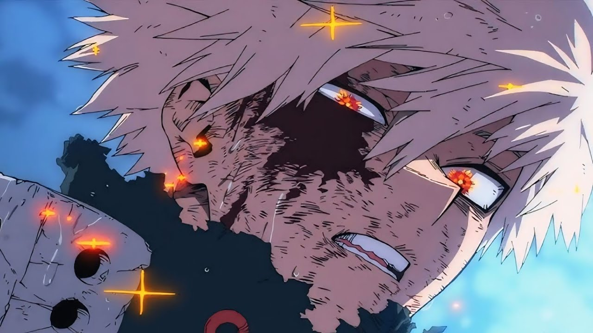

# Introduction
Hi! I'm Yong Yew Sing, a student in the Software Maintenance and Evolution course. 
I expect to learn a lot about modern software maintenance practices and how to work with legacy systems.
- **Fun fact**: I do gym workout during my free time, i've been doing this as my hobby for three years! I also tried muay thai recently and i love it. I used to play guitar a lot before as well.
- **Course expectations**: To gain hands-on experience in maintaining and evolving software.

This is one of my favourite character in my favourite anime -- Katsuki Bakugo, someone who never give up even when he failed and lost to his enemy even during his prime, which makes him keep pushing himself to his new limit. I think this is the best quality you can admire about.
